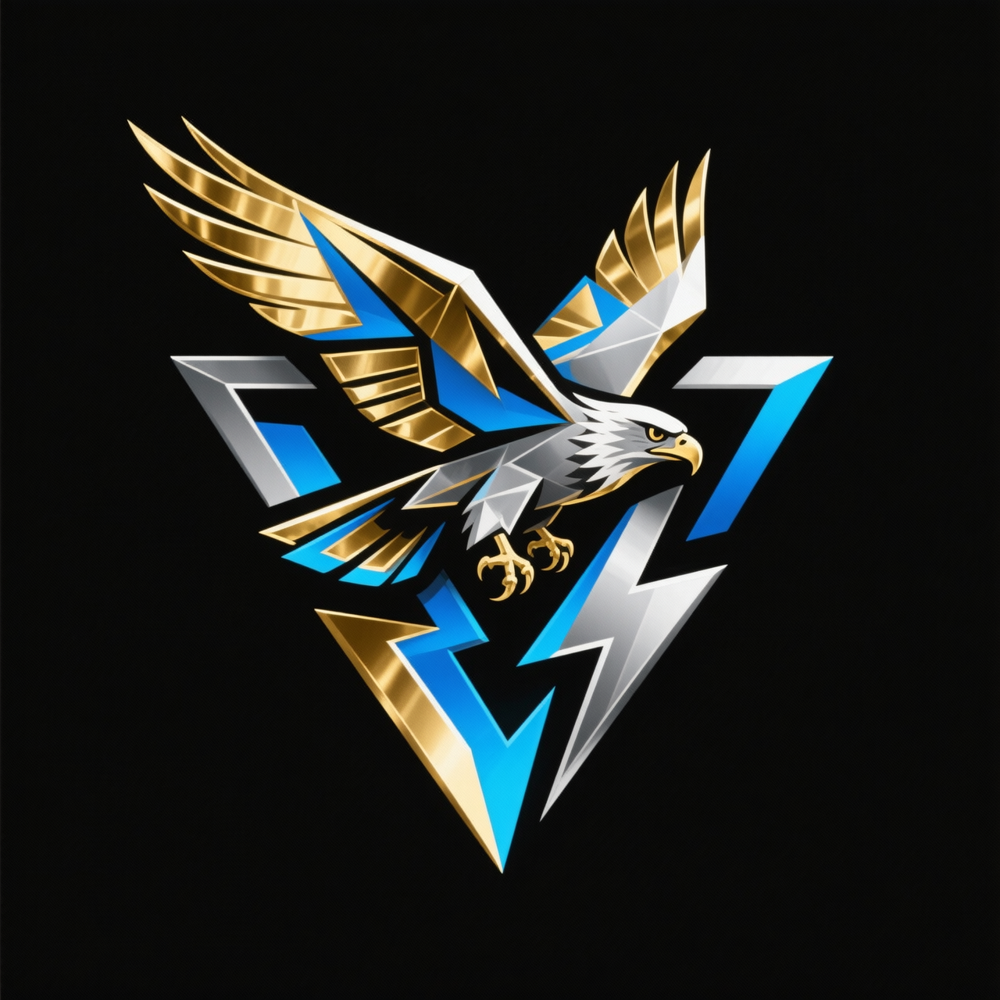

# 先知 (First Vision) - 124c41

> *First vision of the greater good.*

The internet era forced the analog world to be digitised. The AI era forces the digital world to be analoged. Division of labour decided by AI.

---

## 📚 Table of Contents

- [Vision](#-vision)
- [Projects](#-projects)
  - [Games & Entertainment](#games--entertainment)
  - [AI Assistants](#ai-assistants)
  - [Productivity & Utilities](#productivity--utilities)
  - [Data Analysis & Research](#data-analysis--research)
  - [Knowledge Management](#knowledge-management)
  - [Learning & Visualization](#learning--visualization)
  - [Infrastructure](#infrastructure)
- [Contribution Guidelines](#-contribution-guidelines)

---

## 🎯 Vision

As AGI approaches, society faces a critical inflection point:

- **The Problem**: As humanity achieves AGI, basic computing skills are lost
- **The Challenge**: Everyone defaults to digital convenience, but NSFW content is filtered for all
- **The Opportunity**: 1 human decides to learn computing skills and breaks free

This portfolio explores how individual initiative and technical mastery can reclaim agency in an AI-dominated world.

---

## 🚀 Projects

### Games & Entertainment

| Project | Link | Status | Description | Tech Stack |
|---------|------|--------|-------------|-----------|
| **Cinder** | [🔗 cinder.furyhawk.lol](https://cinder.furyhawk.lol/) | 🟢 Active | Browser-based twin-stick shooter vertical slice set in the Foundry. Move, aim, fire, and Surge through escalating enemy waves in a shape-shifting arena, then defeat the Warden boss. | Web/Canvas, TypeScript |
| **Trigonometry Wars** | [🔗 GitHub](https://github.com/furyhawk/opengw.git) | 🟢 Active | Open-source twin-stick arena shooter inspired by Geometry Wars. Control a neon ship, dodge enemies, chase the high score. | Rust/WASM, Web |
| **Beyond All Information** | [🔗 bai.furyhawk.lol](https://bai.furyhawk.lol/) | 🟢 Active | Analyze your [Beyond All Reason](https://www.beyondallreason.info/) RTS games with detailed statistics and meta insights. | Python, ML |

### AI Assistants

| Project | Link | Status | Description | Tech Stack |
|---------|------|--------|-------------|-----------|
| **LLaMA Bot** | [🔗 bot.furyhawk.lol](https://bot.furyhawk.lol/) | 🟢 Active | Multi-capability AI assistant with RAG, web search, and local knowledge base integration. Uses GROQ API + LLaMA 70B for fast inference. | Python, GROQ API, RAG |
| **Stock Analysis Assistant** | [🔗 fin.furyhawk.lol](https://fin.furyhawk.lol/) | 🟢 Active | Financial analysis assistant for stock research and market insights powered by LLaMA 3. | Python, GROQ, LLaMA 3 |
| **Whisper Web** | [🔗 whisper.furyhawk.lol](https://whisper.furyhawk.lol/) | 🟢 Active | Browser-native speech-to-text using OpenAI's Whisper model. No server required—processing happens client-side. | WASM, Whisper, Web |
| **Chat** | ~~[chat.furyhawk.lol](https://chat.furyhawk.lol/)~~ | 🔴 Archived | RAG-powered conversational AI | Python, RAG |

### Productivity & Utilities

| Project | Link | Status | Description | Tech Stack |
|---------|------|--------|-------------|-----------|
| **Nearby Bus** | [🔗 bus.furyhawk.lol](https://bus.furyhawk.lol/) | 🟢 Active | Real-time nearby bus arrival app for public transit navigation. | Web App |
| **Note** | [🔗 note.furyhawk.lol](https://note.furyhawk.lol/) | 🟢 Active | Simple online notepad with cookie-based storage (no server backend). | Vue.js |
| **Pad** | [🔗 pad.furyhawk.lol](https://pad.furyhawk.lol/) | 🟢 Active | Notepad with integrated AI assistance and cookie storage. | Vue.js, LLaMA |
| **Pastebin** | [🔗 bin.furyhawk.lol](https://bin.furyhawk.lol/) | 🟢 Active | Text and file pastebin for quick code/note sharing. | Node.js |
| **Linx** | [🔗 linx.furyhawk.lol](https://linx.furyhawk.lol/) | 🟢 Active | Image pastebin for quick image sharing and hosting. | Go, Linx |
| **SpeedTest** | [🔗 speed.furyhawk.lol](https://speed.furyhawk.lol/) | 🟢 Active | Network speed test utility. | Web App |

### Data Analysis & Research

| Project | Link | Status | Description | Tech Stack |
|---------|------|--------|-------------|-----------|
| **Team Fight Tactics ML** | [🔗 GitHub](https://github.com/furyhawk/tftchamp) | 🟢 Active | Competitive TFT strategy assistant analyzing challenger-level games to predict placement and meta trends. See [Datasets](#team-fight-tactics-datasets) below. | Python, XGBoost, Riot API |
| **Git Server** | [🔗 git.furyhawk.lol](https://git.furyhawk.lol/) | 🟢 Active | Self-hosted Git repository server for version control. | Gitea |

### Knowledge Management

| Project | Link | Status | Description | Tech Stack |
|---------|------|--------|-------------|-----------|
| **Blog** | [🔗 info.furyhawk.lol](https://info.furyhawk.lol/) | 🟢 Active | Long-form writing, tutorials, and insights. | Markdown, Static Site |
| **CheatSheets** | [🔗 cheat.furyhawk.lol](https://cheat.furyhawk.lol/) | 🟢 Active | Quick-reference guides for tools, languages, and frameworks. | Markdown, Static Site |
| **Cookbook** | [🔗 cook.furyhawk.lol](https://cook.furyhawk.lol/) | 🟢 Active | Collection of tested technical recipes and solutions. | Markdown, Static Site |
| **Ghost Blog** | ~~[ghost.furyhawk.lol](https://ghost.furyhawk.lol/)~~ | 🔴 Archived | Full-featured blog platform | Ghost CMS |

### Learning & Visualization

| Project | Link | Status | Description | Tech Stack |
|---------|------|--------|-------------|-----------|
| **Neural Network Playground** | [🔗 GitHub Pages](https://furyhawk.github.io/playground) | 🟢 Active | Interactive visualization to understand neural networks, backpropagation, and deep learning concepts. | JavaScript, D3.js, TensorFlow.js |

### Infrastructure

| Project | Link | Status | Description | Tech Stack |
|---------|------|--------|-------------|-----------|
| **Home Server (Cloudy)** | [🔗 GitHub](https://github.com/furyhawk/cloudy) | 🟢 Active | Complete self-hosted infrastructure stack built for ARM64 using Docker Swarm mode. Orchestrates all services listed above. | Docker Swarm, Kubernetes, ARM64 |
| **Forum** | ~~[forum.furyhawk.lol](https://forum.furyhawk.lol/)~~ | 🔴 Deprecated | Community forum platform | Discourse |
| **Redlib** | ~~[redlib.furyhawk.lol](https://redlib.furyhawk.lol/)~~ | 🔴 Killed | Reddit alternative frontend | Redlib |

---

## 📊 Featured Research: Team Fight Tactics Strategy

### Overview

Competitive Team Fight Tactics (TFT) strategy assistant built on challenger-level gameplay analysis. This project combines web scraping, feature engineering, and machine learning to unlock meta patterns.

### Dataset

**Published**: [Kaggle - Team Fight Tactics Matches](https://www.kaggle.com/datasets/teckmengwong/team-fight-tactics-matches)

- **Source**: Highest ELO challenger games via [Riot API](https://developer.riotgames.com/)
- **Game Format**: 8-player FFA
- **Target Label**: Game placement (1 = best, lower is better)
  - Win: Top 4 placement
  - Loss: Bottom 4 placement (optional binary grouping)
- **Features**: Team compositions, traits, augments, items
- **Exclusions**: game_length, players_eliminated (to prevent learning obvious predictors)

**Feature Importances** (XGBoost):


### Running the Pipeline

```bash
sudo ./scripts/run_pipeline.sh -nrci
```

**Repository**: [furyhawk/tftchamp](https://github.com/furyhawk/tftchamp)

---

## 🛠️ Contribution Guidelines

### Commit Message Format

Follow this structure for clear commit history:

```
<type>: <summary>

<body>

<footer>
```

**Type Options**: `build` | `cicd` | `docs` | `feat` | `fix` | `node` | `refactor` | `test`

**Summary**: Present tense, not capitalized
- ✅ `feat: add neural network visualization`
- ❌ `feat: Added neural network visualization`

### Development Setup

```bash
# Install dependencies
pip install -r requirements.txt

# Or using uv (faster)
uv sync
```

### Deployment

**MkDocs Build & Deploy**:

```bash
# Local preview
mkdocs serve

# Deploy to GitHub Pages
mkdocs gh-deploy
```

**Manual Deployment**:

```bash
mkdocs build
scp -r ./site user@host:/path/to/server/root
```

---

## 📚 Tutorials

### Web Scraping with Python

**Objective**: Learn how to ethically scrape and analyze web data at scale.

**Topics Covered**:
- Using `requests` and `Beautiful Soup` for web scraping
- Parsing company data from [companiesmarketcap.com](https://companiesmarketcap.com/)
- Fetching financial details from [finance.yahoo.com](https://finance.yahoo.com/)
- Scaling from single row → full page → multi-page scraping (6000+ companies)
- Data preprocessing and transformation
- Visualization with `matplotlib`

**Skills Gained**: HTTP requests, HTML parsing, data wrangling, visualization

---

## 🌐 Self-Hosted Infrastructure

All services run on **personal infrastructure** using Docker Swarm on ARM64 hardware. This setup provides:

- **Reliability**: Self-hosted means no dependency on third-party platforms
- **Privacy**: Your data stays in your control
- **Customization**: Full control over features and integrations
- **Learning**: Deep understanding of DevOps and system architecture

---

## 📄 License & Attribution

Each project maintains its own license. See individual repositories for details.

**Repository**: [furyhawk/124c41](https://github.com/furyhawk/124c41)

**Documentation**: [furyhawk.github.io/124c41](https://furyhawk.github.io/124c41/)
